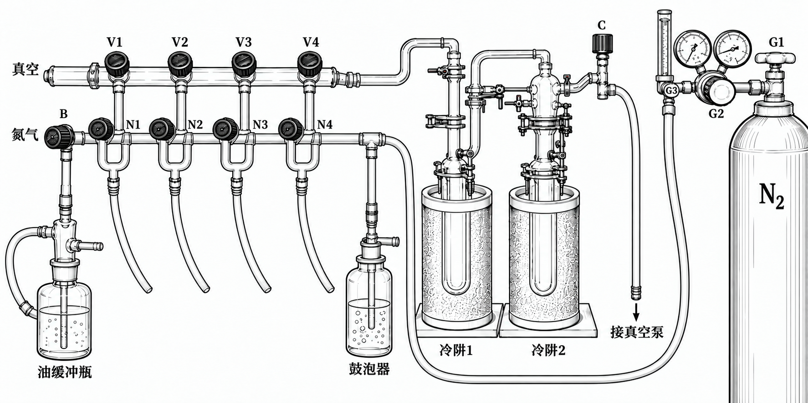

import { Steps } from '@astrojs/starlight/components';

| 项目 | 内容 |
|---|---|
| SOP 编号 | SY-003 |
| 版本 | v0.1（草稿） |
| 作者 | （待填写） |
| 审核人 | （待填写） |
| 依据记录 | 《苯共沸液氮除水操作整理》（Word 文档） |

:::note[标注说明]
- **【原】**：原始操作记录。
- **【补充】**：整理时补充的检查项或注意事项。
- **【澄清】**：对原记录含义的解释。
:::

## 1. 目的

用于 NCA 单体（如 [His(Trt)-NCA](/synthesis/his-trt-nca/) 第三天）的最后除水。苯与水形成共沸物，冻实的苯在高真空下升华，把残余水一起带走，产物保持分散，得到蓬松粉末。**全程不能让苯化开。**

## 2. 双排管与阀门编号

| 代号 | 位置 |
|---|---|
| V1–V4 | 上排真空阀（从左到右） |
| N1–N4 | 下排氮气阀（从左到右） |
| S | 样品瓶自带单通 |
| B | 油缓冲阀 |
| C | 冷阱右侧隔离阀 |
| G1 / G2 / G3 | 氮气瓶总阀 / 减压调节旋钮 / 流量调节阀 |

图中阀门只标位置，不表示开闭状态。下文以样品接在第 2 支路（V2 / N2）为例。

## 3. 安全注意事项

:::danger[苯与液氮]
- 苯为一类致癌物：加苯在手套箱内完成，冷阱回收的苯在通风处处理，戴手套。
- 液氮操作戴护目镜和防冻手套。
- 冷阱处于液氮冷却状态时不要对空气长时间敞开，以免冷凝出液氧；放气前先撤去冷阱的液氮杜瓦瓶（见第 7 步）。
:::

## 4. 操作步骤

### 4.1 准备冷阱与真空系统

- 【原】先装冷阱和液氮瓶，打开泵。
- 【补充】两只冷阱均应装妥、密封并抽空后再浸入液氮；检查玻璃、接头、冷阱通畅及液氮余量。

### 4.2 手套箱内加苯并密闭

按 **样品 100 mg : 苯 1 mL** 的比例加苯。圆底烧瓶磨口涂真空脂并连接单通，或按原记录使用反应茄瓶加橡胶塞；关紧单通后取出。取出后超声，使体系成为均匀液体。

### 4.3 用液氮冻透样品

液氮盆中加液氮，放入烧瓶冻结；尽量平放，使物料冻在瓶体中部。冻几秒取出轻摇数下，再冻。冻住后倒置检查瓶底有无未冻结液体，放入另一液氮盆并重复倒置检查几次，直至冻透。

### 4.4 接入双排管并开始抽除

**开阀顺序：V2 → S；N2 保持关闭。**

- 【原】S 先保持关闭，连接蓝色软管；先打开对应上排真空阀 V2，表读数降至 **80 以下**，再打开 S。随时注意补液氮。
- 【原】若同时处理两份样品，第一份接入后读数已有下降趋势，即可打开第二份的单通；各用各的对应支路。
- 【补充】抽真空时，对应下排氮气阀 N2 保持关闭，避免把氮气主管同时接通；未使用的支路阀保持关闭。

### 4.5 撤样品液氮盆并观察抽干过程

- 【原】读数降至约 **60** 的极限、且不再下降后，再撤去样品液氮盆。撤盆后读数会先上升后下降，需持续观察；示数升高时按原记录补液氮。
- 【原／澄清】不要让含样品的苯体系融化。烧瓶底部出现气泡、将要融化时，应立即复冻。原记录中的良好现象是黄色部位开始变白，解释为苯正在被抽走。
- 【原】底面约 90% 的黄色部位变白后，可轻摇、轻拍烧瓶，使粉末自然落底，增加接触面积。继续抽至摇晃时无清脆声；原记录把有清脆声解释为仍有冰晶。后续轻振粉末，如仍出现气孔，原记录解释为还有苯，应继续至不再出现气孔。

### 4.6 判断终点并隔离样品

**关阀顺序：S → V2。**

【原】上述现象达到后，表读数长期维持 60 以下即可停止。按相反顺序关闭：先关 S，再关对应上排真空阀 V2，随后把烧瓶放到一旁。

### 4.7 停机与冷阱放气

- 【澄清】放入空气前，已经移开冷阱的液氮杜瓦瓶，使两只冷阱脱离液氮浴。
- 【原】按以下顺序操作，原文要求从开 V1 起动作要快：

<Steps>

1. 关冷阱右侧阀 C

2. 关泵

3. 开从左到右第一个真空阀 V1

4. 开 C

5. 通大气压

6. 卸冷阱

</Steps>

- 【澄清】V1 是最左工作支路，末端连空气；这里放入的是空气。

### 4.8 冷阱清洗与收纳

【原／澄清】冷阱放入塑料烧杯（背后最上层架子）。若苯融化慢，可在烧杯中加水，作为冷阱外侧水浴；苯融化后倒入指定有机废液容器。用乙醇润洗 2 遍，洗液也收集至指定废液容器；最后倒扣在垫纸的塑料烧杯中。

## 5. 修订记录

| 版本 | 日期 | 修订人 | 修订内容 |
|---|---|---|---|
| v0.1 | 2026-10-27 | — | 根据《苯共沸液氮除水操作整理》Word 文档整理 |
